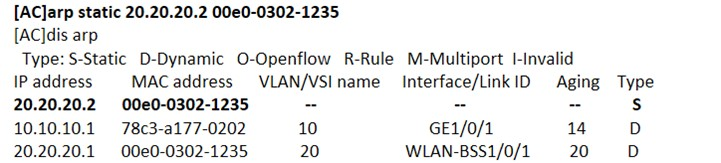
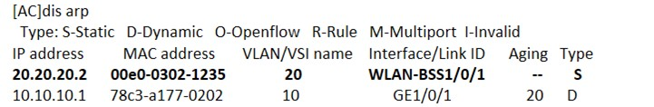
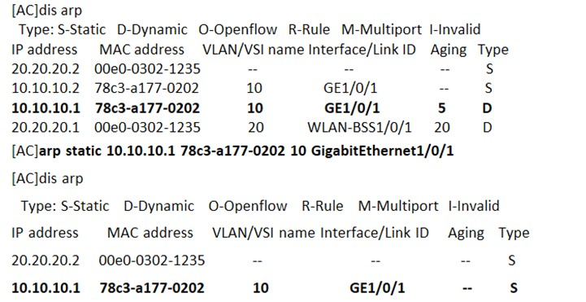

# 工程名称：
静态ARP绑定配置举例

ARP（Address Resolution Protocol，地址解析协议）是将IP地址解析为以太网MAC地址（或称物理地址）的协议。在网络中，当主机或其它网络设备有数据要发送给另一个主机或设备时，它必须知道对方的网络层地址（即IP地址），由于IP数据报必须封装成帧才能通过物理网络发送，因此还需要知道对方的物理地址，所以设备上需要存在一个从IP地址到物理地址的映射关系。ARP就是实现这个功能的协议。

设备通过ARP解析到目的MAC地址后，将会在自己的ARP表中增加IP地址和MAC地址映射关系的表项，以用于后续到同一目的地报文的转发。
ARP表项分为动态ARP表项、静态ARP表项和Rule ARP表项。

静态ARP表项通过手工配置和维护，不会被老化，不会被动态ARP表项覆盖。
配置静态ARP表项可以增加通信的安全性。静态ARP表项可以限制和指定IP地址的设备通信时只使用指定的MAC地址，此时攻击报文无法修改此表项的IP地址和MAC地址的映射关系，从而保护了本设备和指定设备间的正常通信。

## 需求：
配置静态ARP绑定。静态ARP表项分为短静态ARP表项、长静态ARP表项。

·     长静态ARP表项可以直接用于报文转发，除了包括IP地址和MAC地址外，还需要包括以下两种表项内容之一：
¡     该ARP表项所在VLAN和出接口；
¡     该ARP表项的入接口和出接口对应关系。

·     短静态ARP表项只包括IP地址和MAC地址。
如果出接口是三层以太网接口，短静态ARP表项可以直接用于报文转发。
如果出接口是VLAN接口，短静态ARP表项不能直接用于报文转发，需要对表项进行解析：当要发送IP数据报时，设备先发送ARP请求报文，如果收到的响应报文中的发送端IP地址和发送端MAC地址与所配置的IP地址和MAC地址相同，则将接收ARP响应报文的接口加入该静态ARP表项中，此时，该短静态ARP表项由未解析状态变为解析状态，之后就可以用于报文转发。
一般情况下，ARP动态执行并自动寻求IP地址到以太网MAC地址的解析，无需管理员的介入。当希望设备和指定用户只能使用某个固定的IP地址和MAC地址通信时，可以配置短静态ARP表项，当进一步希望限定这个用户只在某VLAN内的某个特定接口上连接时就可以配置长静态ARP表项。

## 实验步骤：

静态ARP表项在设备正常工作期间一直有效。

1 手工添加短静态ARP表项

进入系统视图
system-view

手工添加短静态ARP表项
arp static *ip-address mac-address*

2 手工添加长静态ARP表项

进入系统视图
system-view

手工添加长静态ARP表项
arp static ip-address mac-address [ vlan-id interface-type interface-number ]

## 测试结果：

1 手工添加短静态ARP表项

可以看到添加的静态arp为第一条，可以看到00e0-0302-1235有动态静态两条arp，这是由于短静态arp需要解析才能生效

下面我们让这个终端使用20.20.20.2的地址，可以看到静态arp已经生效

2 手工添加长静态ARP表项

添加完长静态arp表项后，动态arp被静态arp覆盖

## 说明： 

1 对于已经解析的短静态ARP表项，会由于外部事件，比如解析到的出接口状态down或设备的ARP表项所对应的VLAN或VLAN接口被删除等原因，恢复到未解析状态。

2 长静态ARP表项根据设备的当前状态可能处于有效或无效两种状态。处于无效状态的原因可能是该ARP表项中的IP地址与本地IP地址冲突或设备上没有与该ARP表项中的IP地址在同一网段的接口地址等原因。处于无效状态的长静态ARP表项不能指导报文转发。当长静态ARP表项所对应的VLAN或VLAN接口被删除时，该ARP表项会被删除。
